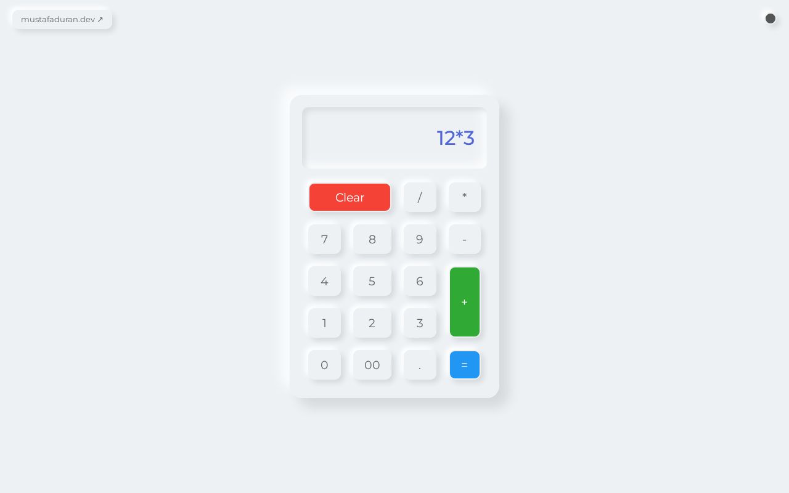

# Simple Calculator

A small calculator built with plain HTML, CSS and JavaScript. It uses a soft "neumorphism" look and has a light/dark theme switch.



## Features

- Basic arithmetic: addition, subtraction, multiplication and division
- Decimal point and a `00` key
- `Clear` button to reset the display
- Light and dark theme, toggled with the round button in the top-right corner
- No build step and no dependencies (only the Montserrat font from Google Fonts)

## How to run

Open `index.html` in a browser.

Or serve the folder locally:

```bash
python -m http.server
```

and visit http://localhost:8000.

## Project structure

```
.
├── index.html          # Markup: display and buttons
├── style.css           # Layout, neumorphism styling and dark theme
├── script.js           # Button handling, evaluation and theme toggle
└── docs/
    └── screenshot.png  # Screenshot used in this README
```

## Tech

- HTML
- CSS (CSS Grid for the keypad)
- JavaScript (vanilla, no libraries)

## Background

Built in January 2023 as a high-school project and published on [mustafaduran.dev](https://mustafaduran.dev/projects/project1/).

## License

MIT © 2023 Mustafa Duran. See [LICENSE](LICENSE).
